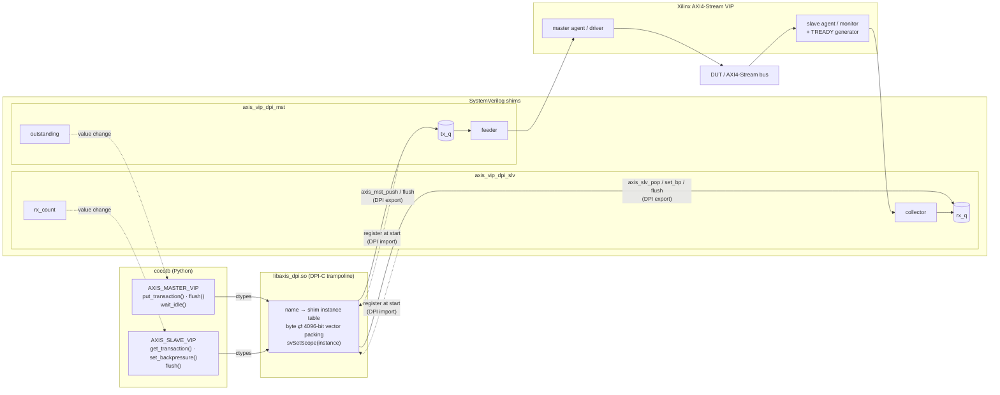
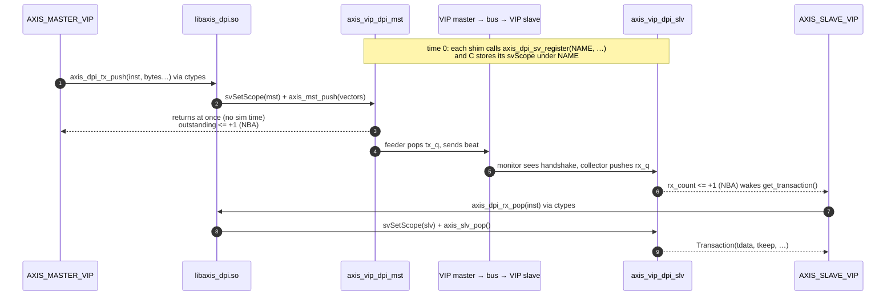

# cocotbext-axi-vip-shims

> [!CAUTION]
>    This repository is 100% vibe coded as a personal profiling project and experimental test playground.
>    Standard disclaimer applies: it works on my machine, edge cases may be ignored, and architectural decisions were made based on vibes.
>    You are completely free to use, fork, extend, modify, or break it for your own purposes. No warranties provided, but PRs and feedback are welcome!

> [!NOTE]
> **Motivation**
>
> I really like verifying with cocotb:
>
> - **Golden models are easy to write**, especially for signal processing and
>   complex algorithms, with Python libraries such as NumPy and SciPy.
> - **It runs inside pytest, so you control every step**:
>   - a pre-test routine that compiles the sources your way,
>   - a post-test routine for coverage analysis and the like,
>   - all of it vendor independent.
>
> Modern FPGA development relies heavily on interfaces. In professional work
> especially, you need to be sure your protocols, namely AXI4 (Stream, Lite and
> Full), are implemented correctly. So far the usual approach has been AXI
> drivers written in cocotb. In my experience those work, but I'm never sure
> they are always correct. For professional designs I think a better approach is
> a Python/cocotb front-end class that talks over a DPI-C interface to a
> top-level testbench holding the DUT and the Xilinx AXI VIP cores.
>
> Also, when you simulate large stimulus sets, you want as few calls between
> cocotb and the simulator as possible. Queue-based C interfacing can then make
> the simulation run faster in real time (see [Benchmark](#benchmark)).

Drive the Xilinx AXI VIPs from [cocotb](https://www.cocotb.org/) through thin
SystemVerilog + DPI-C shims.

The shims add no behaviour of their own. One `put_transaction()` call in Python
is one AXI4-Stream transfer on the bus, with exactly the TDATA / TKEEP / TSTRB /
TLAST / TID / TDEST / TUSER values you passed. On the receive side, every beat
the VIP collects is handed back unchanged. Packet framing, TLAST handling and
TKEEP masking are up to the testbench.

Currently supported:

| VIP                 | Shim modules                           | Python classes                      |
|---------------------|----------------------------------------|-------------------------------------|
| AXI4-Stream (PG277) | `axis_vip_dpi_mst`, `axis_vip_dpi_slv` | `AXIS_MASTER_VIP`, `AXIS_SLAVE_VIP` |

## How it works



Solid arrows carry data. Dotted arrows are the one-time registration and the
status signals that cocotb waits on.

One transfer, from `put_transaction()` to `get_transaction()`:



- **SystemVerilog shim** ([axis_vip_dpi.sv](src/axi_vip_shims/axi_stream_vip_shim/src/hdl/axis_vip_dpi.sv)):
  holds the queues and talks to the VIP agent. All VIP API calls live in
  `vip_*` tasks, so they are easy to adapt to a different Vivado version.
- **DPI-C trampoline** ([axis_dpi.cpp](src/axi_vip_shims/axi_stream_vip_shim/src/dpi_c/axis_dpi.cpp)):
  a name → shim-instance table. It packs bytes into 4096-bit DPI vectors and
  calls the shim's exported functions with `svSetScope()` set to the right
  instance.
- **cocotb front end** ([axis_vip_dpi.py](src/axi_vip_shims/axi_stream_vip_shim/src/python/axis_vip_dpi.py)):
  loads the same `.so` with `ctypes` and checks every call against the
  interface you declared.

DPI is crossed only when cocotb pushes, pops, flushes or changes backpressure.
The shims never poll C, and cocotb waits on status signals the shims drive
(`outstanding` on the master, `rx_count` on the slave). An idle interface
therefore costs no DPI calls and no clock-edge wakeups.

The simulator (`-sv_lib`) and cocotb (`ctypes.CDLL`) must load **the same
file**, so that they share one instance table. If they don't, the first call
fails with "has not registered".

## Layout

```
CMakeLists.txt, src/CMakeLists.txt
install.sh                       venv + build + tests in one go
Makefile                         make / make test / make clean
requirements.txt, conftest.py
pytest.ini, .coveragerc          coverage on every pytest run (see [Coverage](#coverage))
src/axi_vip_shims/axi_stream_vip_shim/
  CMakeLists.txt
  src/hdl/axis_vip_dpi.sv        SV shims (master + slave)
  src/dpi_c/axis_dpi.cpp         DPI-C trampoline
  src/python/axis_vip_dpi.py      cocotb classes
examples/axis_byteswap/          standalone project using the shims (see [Examples](#examples))
test/axi_vip_shims/axi_stream_vip_shims/
  hdl/tb_top.sv                  VIP master -> VIP slave loopback (+ plain bus for the benchmark)
  hdl/gen_vip.tcl                generates the two VIP cores in Vivado batch mode
  test_cases/test_axis_vip.py    functional cocotb tests, one per AXI4-Stream option
  test_cases/test_axis_benchmark.py  benchmark: VIP shims vs cocotbext-axi
  python/questa_common.py        shared Questa flow: VIP sources, build, run
  python/test_axis_vip_questa_runner.py  runs test_cases/test_axis_vip.py on Questa
  python/test_axis_benchmark_runner.py  runs test_cases/test_axis_benchmark.py on Questa
  python/verilator_common.py     shared Verilator flow (reuses the VIP source discovery above)
  python/test_axis_vip_verilator_runner.py        test_axis_vip.py on Verilator
  python/test_axis_benchmark_verilator_runner.py  test_axis_benchmark.py on Verilator
  python/test_c_side.py          simulator-free test of the C + Python layers
  dpi_c/test_c_side_mock.c       mock simulator/SV side for test_c_side.py
  artifacts/<runner>/            one dir per runner: logs, waves, results (generated,
                                 see [Test artifacts](#test-artifacts))
lib/                             built shared libraries (generated)
build/                           CMake build, generated VIP cores, Questa work library,
                                 Verilator models (build/sim_build_verilator, _cov),
                                 coverage reports (build/coverage)
```

## Requirements

- Vivado with the AXI4-Stream VIP. You need a master and a slave VIP
  customised for your interface. For the test bench,
  [gen_vip.tcl](test/axi_vip_shims/axi_stream_vip_shims/hdl/gen_vip.tcl)
  generates them in Vivado batch mode.
- A simulator that supports DPI-C and that cocotb can drive, and that handles
  the Xilinx VIP's SystemVerilog classes. Tested with:
  - Questa Altera Starter FPGA Edition 2025.2 (see [Questa notes](#questa-notes)),
  - Verilator 5.052 (see [Verilator notes](#verilator-notes)). Verilator
    5.032 can't build the bench.

  GHDL (VHDL only) doesn't work (see [Other simulators](#other-simulators)).
- Python 3 and cocotb.
- A C99 and a C++17 compiler, and CMake ≥ 3.16.

## Building the DPI library

```sh
cmake -B build
cmake --build build
```

This produces:

- `libaxis_dpi.so`: load it in the simulator and in cocotb.
- `libaxis_dpi_test.so`: `axis_dpi.cpp` linked with the mock. Used only by the
  simulator-free test.
- `libaxis_dpi_cov.so`: `libaxis_dpi.so` built with `--coverage`. The
  functional simulation tests load it in place of `libaxis_dpi.so` (see
  [Coverage](#coverage)).

The two test libraries are built with `--coverage`. Turn that off with
`-DAXI_VIP_SHIMS_TEST_COVERAGE=OFF` (then there's no `libaxis_dpi_cov.so`), or
leave out both test libraries with `-DAXI_VIP_SHIMS_BUILD_TEST_LIBS=OFF`.
`libaxis_dpi.so` is never instrumented.

All of them land in the top-level `lib/` (set by `AXI_VIP_SHIMS_LIB_DIR`).

The library is deliberately linked **without** `-Wl,--no-undefined`.
`svGetScope` / `svSetScope` and the SV exports are resolved by the simulator at
load time. The exports are weak, so a design that only has masters (or only
slaves) still loads.

## Using it in a testbench

### 1. Instantiate the shims next to the VIPs

The shim parameters must match the VIP customisation:

```systemverilog
axis_vip_dpi_mst #(.NAME("mst0"), .DATA_BYTES(4),
                   .HAS_TKEEP(1), .HAS_TSTRB(1), .HAS_TLAST(1),
                   .ID_W(4), .DEST_W(4), .USER_W(4))
                   mst_shim (.aclk(aclk));

axis_vip_dpi_slv #(.NAME("slv0"), .DATA_BYTES(4),
                   .HAS_TKEEP(1), .HAS_TSTRB(1), .HAS_TLAST(1),
                   .ID_W(4), .DEST_W(4), .USER_W(4))
                   slv_shim ();
```

The shims find the VIP package, agent type and virtual interface through
macros. Their defaults match [tb_top.sv](test/axi_vip_shims/axi_stream_vip_shims/hdl/tb_top.sv);
override them at compile time to match your component and instance names:

| Macro              | Default                         |
|--------------------|---------------------------------|
| `AXIS_MST_VIP_PKG` | `axi4stream_vip_mst_pkg`        |
| `AXIS_MST_AGENT_T` | `axi4stream_vip_mst_mst_t`      |
| `AXIS_MST_VIF`     | `tb_top.mst_vip.inst.IF`        |
| `AXIS_SLV_VIP_PKG` | `axi4stream_vip_slv_pkg`        |
| `AXIS_SLV_AGENT_T` | `axi4stream_vip_slv_slv_t`      |
| `AXIS_SLV_VIF`     | `tb_top.slv_vip.inst.IF`        |

Slave-only parameters:

- `HARD_RESTART_ON_BP` (default 1): restarts the slave driver for every new
  TREADY pattern, so the pattern takes effect at once. Without it, the VIP
  queues the new pattern behind the running one. It then starts only after the
  current low/high period, after the next handshake for `"none"`, and never
  after a `"stall"`.
- `STALL_CYCLES`: the low time used for `"stall"`.

### 2. Load the library in both places

- Simulator: `-sv_lib /path/to/lib/libaxis_dpi` (or your simulator's
  equivalent). Verilator has no `-sv_lib`: link the `.so` into the model
  instead (see [Verilator notes](#verilator-notes)).
- cocotb: `AXIS_DPI_LIB=/path/to/lib/libaxis_dpi.so`, or pass
  `lib_path=` to the constructor.

### 3. Drive it from cocotb

```python
from cocotb.triggers import with_timeout
from axis_vip_dpi import AXIS_MASTER_VIP, AXIS_SLAVE_VIP

IFACE = dict(tdata_width=32, has_tkeep=True, has_tstrb=True, has_tlast=True,
             tid_width=4, tdest_width=4, tuser_width=4)

mst = AXIS_MASTER_VIP("mst0", dut.mst_shim, **IFACE)   # name == shim NAME
slv = AXIS_SLAVE_VIP("slv0", dut.slv_shim, **IFACE)

mst.put_transaction(tdata=0x11111111, tlast=False, tid=2)
mst.put_transaction(tdata=0x22222222, tlast=True, tkeep=0b0011, tstrb=0b0011)

slv.set_backpressure("random", low=(0, 8), high=(1, 4))
t = await with_timeout(slv.get_transaction(), 100, "us")
# Transaction(tdata, tkeep, tstrb, tlast, tid, tdest, tuser)

await mst.wait_idle()
```

The constructor describes the interface. On first use, the description is
checked against the shim's parameters and any mismatch is reported field by
field. You can call `check()` to run that check early.

## Examples

[examples/axis_byteswap/](examples/axis_byteswap/) is a small standalone
project that tests its own DUT through the shims. It is laid out like a
separate repository that has the shims as a git submodule. It shows how to
build `libaxis_dpi.so` from your own CMake (`add_subdirectory`), how to compile
the VIP and shim sources with your bench, how to override the shim macros for
your VIP component names, and how to run the bench on Verilator and on Questa:

```sh
cd examples/axis_byteswap && pytest    # SIM=questa pytest for Questa
```

## API summary

**Common**

| Call      | Effect |
|-----------|--------|
| `check()` | Verify the Python description against the SV shim now. |
| `flush()` | Drop transfers queued in the shim. Transfers already handed to the VIP are not affected. |

**`AXIS_MASTER_VIP`**

| Call / attribute | Effect |
|------------------|--------|
| `put_transaction(tdata, *, tkeep, tstrb, tlast, tid, tdest, tuser, delay=0)` | Queue one transfer. Returns immediately and consumes no sim time. `tdata` is an int or exactly `tdata_width/8` little-endian bytes. `tlast` is required when the interface has TLAST. Passing a signal the interface lacks raises `TypeError`. A value too wide for its signal raises `ValueError`. |
| `outstanding` | Transfers queued but not yet on the bus. |
| `await wait_idle()` | Wait until everything queued so far has been sent. Don't call it while the sink is stalled. |

**`AXIS_SLAVE_VIP`**

| Call / attribute | Effect |
|------------------|--------|
| `set_backpressure(mode, low, high)` | Takes effect immediately. `mode` is one of `"none"`, `"osc"`, `"random"` (with `(min, max)` ranges) or `"stall"`. |
| `stall()` / `release()` | Shorthand for `"stall"` / `"none"`. |
| `pending` | Beats received and not yet read. |
| `try_get_transaction()` | Return the oldest `Transaction`, or `None` if nothing has arrived. |
| `await get_transaction()` | Wait for the next `Transaction`. |

Signals that the interface doesn't have come back as `None`. There is no
built-in timeout; wrap waits in `cocotb.triggers.with_timeout()`.

The VIP drives noise on null bytes (TKEEP=0) and position bytes (TSTRB=0), as
AXI4-Stream allows. Compare only data bytes (TKEEP=1 and TSTRB=1). If you pass
`tkeep` without `tstrb`, TSTRB defaults to all ones, which is not allowed where
TKEEP=0. Pass both.

## Debug log

Set `AXIS_DPI_DEBUG=1` in the environment of the simulation to log every call
in all three layers. The runners pass the environment through, for example:

```bash
AXIS_DPI_DEBUG=1 TESTCASE=test_tdata pytest test/axi_vip_shims/axi_stream_vip_shims/python/test_axis_vip_verilator_runner.py
```

One transfer then reads, in the test's log:

```text
   245.00ns DEBUG    cocotb.axis_vip_dpi.mst0   put tdata=0x04030201 tlast=1 delay=0
axis_dpi: mst0: tx_push data=0x04030201 keep=0x0f strb=0x0f user=0x00 last=1 id=0 dest=0 delay=0
245 ns axis_vip_dpi_mst mst0: push from cocotb: data=0x04030201 ... (tx_q=101, outstanding=101)
1235 ns axis_vip_dpi_mst mst0: to VIP driver: data=0x04030201 ... (tx_q=0)
1255 ns axis_vip_dpi_slv slv0: from VIP monitor: data=0x04030201 ... (rx_q=1)
1255 ns axis_vip_dpi_slv slv0: pop from cocotb: data=0x04030201 ... (rx_q=0)
axis_dpi: slv0: rx_pop data=0x04030201 keep=0x0f strb=0x0f user=0x00 last=1 id=0 dest=0
  1255.00ns DEBUG    cocotb.axis_vip_dpi.slv0   get tdata=0x04030201 tkeep=0xf ...
```

| Prefix | Layer | Logs |
|--------|-------|------|
| `cocotb.axis_vip_dpi.<name>` | Python | constructor, config check, `put`, `get` (and empty polls), `flush`, `set_backpressure`, `wait_idle` |
| `axis_dpi:` | C library | registration from SV and cocotb, config check, every DPI call with its arguments, error codes |
| `axis_vip_dpi_mst` / `_slv` | SV shim | every export call, beats handed to the VIP driver, VIP driver idle, beats from the VIP monitor, backpressure applied |

The C library reads the variable once when it loads; the shims and the Python
classes ask it (`axis_dpi_debug()`), so set it before the simulation starts.
`COCOTB_LOG_LEVEL=DEBUG` alone turns on the Python lines only. With the
variable unset, each log point costs one flag test.

## Tests

- **Simulator-free** ([test_c_side.py](test/axi_vip_shims/axi_stream_vip_shims/python/test_c_side.py)):
  loads `lib/libaxis_dpi_test.so` (`axis_dpi.cpp` linked with a mock of the
  simulator and SV side), then checks the C trampoline, scope handling, vector
  packing and the Python API. Build the library with CMake first. The test
  needs cocotb importable, but no simulator.

  ```sh
  cmake -B build && cmake --build build
  pytest      # from the repo root
  ```

- **Full simulation** ([test_axis_vip.py](test/axi_vip_shims/axi_stream_vip_shims/test_cases/test_axis_vip.py)):
  runs against [tb_top.sv](test/axi_vip_shims/axi_stream_vip_shims/hdl/tb_top.sv),
  a VIP master → VIP slave loopback. There is one test per AXI4-Stream
  option: TDATA, TKEEP, TSTRB, TLAST, TID, TDEST, TUSER, `delay`, each
  backpressure mode (none, osc, random, stall/release, change in flight),
  `flush()`, `wait_idle()`, argument checking and constructor mismatch
  detection. A monitor on the bus wires checks delays and backpressure by the
  cycle. The tests are started by
  [test_axis_vip_questa_runner.py](test/axi_vip_shims/axi_stream_vip_shims/python/test_axis_vip_questa_runner.py),
  which generates the VIP cores into `build/ip/` on first run:

  ```sh
  python3 test/axi_vip_shims/axi_stream_vip_shims/python/test_axis_vip_questa_runner.py
  ```

  It finds Vivado through `XILINX_VIVADO` or `vivado` on `PATH`. Each cocotb
  test runs in its own `vsim`, with its log in
  `artifacts/test_axis_vip_questa_runner/logs/<test>.log` and all signals recorded
  to `artifacts/test_axis_vip_questa_runner/wlf/<test>.wlf` (see
  [Test artifacts](#test-artifacts)). Open a waveform with
  `vsim -view <path>/wlf/test_tdata.wlf`. Set `WAVES=0` to
  skip recording, `GUI=1` to open the GUI, or `TESTCASE=<name>` to run one
  test. `./install.sh` builds everything and runs both test sets.

- **Full simulation on Verilator**
  ([test_axis_vip_verilator_runner.py](test/axi_vip_shims/axi_stream_vip_shims/python/test_axis_vip_verilator_runner.py)):
  the same tests and VIP sources, built into one Verilator model under
  `build/sim_build_verilator_cov/` under pytest (instrumented for
  [Coverage](#coverage)), or `build/sim_build_verilator/` when run as a
  script, with `EXT_SHIMS_COVERAGE=0`, and for the benchmark:

  ```sh
  python3 test/axi_vip_shims/axi_stream_vip_shims/python/test_axis_vip_verilator_runner.py
  pytest test/axi_vip_shims/axi_stream_vip_shims/python/test_axis_vip_verilator_runner.py
  ```

  Under pytest it is skipped when `verilator` is not on `PATH`. Each cocotb
  test runs in its own model run. Logs go to
  `artifacts/test_axis_vip_verilator_runner/logs/<test>.log` and waveforms
  to `.../vcd/<test>.vcd` (view with GTKWave or Surfer). `WAVES=0`, `GUI=1` (opens GTKWave after one
  run of all selected tests) and `TESTCASE=<a>,<b>` work as on Questa. Waves
  are a build-time option in Verilator, so `WAVES=0` builds the model without
  tracing.

  With Verilator 5.052, 18 of the 19 tests pass. `test_flush_slave` fails:
  five cycles after `wait_idle()`, `pending` shows 4 beats instead of 5.

### Coverage

Every `pytest` (or `pytest -s`) run from the repo root reports coverage of
all the shim code at the end of the run. The Xilinx VIP and any DUT are left
out.

| Layer | Measured with | Where it runs | Report |
|-------|---------------|---------------|--------|
| Python `axis_vip_dpi.py` | pytest-cov ([pytest.ini](pytest.ini), [.coveragerc](.coveragerc)) in-process; cocotb's own coverage (`COCOTB_USER_COVERAGE`) inside the simulator; combined | `test_c_side.py`, functional simulation tests | `build/coverage/python/` |
| C `axis_dpi.cpp` | gcov + gcovr: `libaxis_dpi_test.so` in-process, `libaxis_dpi_cov.so` in the simulator; combined | both | `build/coverage/c/` |
| SV `axis_vip_dpi.sv`, `tb_top.sv` | Verilator `--coverage-line --coverage-expr`; Questa `+cover=bcse` | functional simulation tests | `build/coverage/sv_verilator/`, `build/coverage/sv_questa/` |

- Each simulation run saves its SV data into `build/coverage/raw/<sim>/<test>`.
  At the end, the runs are merged (`verilator_coverage --write`,
  `vcover merge`) and reported. Verilator gives an annotated source and an
  lcov `coverage.info`; Questa gives an HTML report.
- Only the shims and the bench are instrumented. Verilator gets a generated
  `coverage.vlt` that switches coverage off for every Xilinx VIP file. Questa
  selects the design units `axis_dpi_pkg`, `axis_vip_dpi_mst`,
  `axis_vip_dpi_slv` and `tb_top`.
- There is no toggle coverage. The shims pass 4096-bit DPI vectors, and their
  unused upper bits would swamp the number.
- The benchmarks never collect coverage, so it can't skew their timings. They
  keep the uninstrumented `libaxis_dpi.so` and their own Verilator model.
- Coverage is collected only under pytest (`pytest -s` from the repo root).
  A runner started as a script (`python3 test_axis_vip_*_runner.py`) runs
  without it. [conftest.py](conftest.py) resets the C and SV data when the
  session starts. `EXT_SHIMS_COVERAGE=0` turns coverage off under pytest too.
  The switch isn't called `COVERAGE`, because cocotb reads that name as a
  (deprecated) switch for its own coverage.
- The Python and C reports are also written as Cobertura XML
  (`build/coverage/{python,c}/coverage.xml`), for tools such as Codecov or an
  IDE coverage view.

CI uploads `build/coverage/` (without the raw data) as artifacts:
`coverage-unit-py<version>` (Python and C, simulator-free) and
`coverage-verilator` (all three layers, from the Verilator simulation).

The shared code is in
[coverage_common.py](test/axi_vip_shims/axi_stream_vip_shims/python/coverage_common.py).
For HDL coverage of your own DUT, see the
[example](examples/axis_byteswap/README.md#coverage).

### Test artifacts

Every runner writes into its own directory under
`test/axi_vip_shims/axi_stream_vip_shims/artifacts/`, named after the runner
script, and only what applies to it:

```
artifacts/
  test_axis_vip_questa_runner/           build.log  logs/<test>.log  wlf/<test>.wlf
  test_axis_vip_verilator_runner/        build.log  logs/<test>.log  vcd/<test>.vcd
  test_axis_benchmark_runner/            build.log  logs/<test>.log  results/  benchmark.txt
  test_axis_benchmark_verilator_runner/  build.log  logs/<test>.log  results/  benchmark.txt
```

- `build.log` is the log of the build this run used. The Questa runners share
  one build in `build/sim_build_questa/`, so the same log can show up in two
  directories. The Verilator runners build into `build/sim_build_verilator_cov/`
  (functional tests under pytest, with coverage) and `build/sim_build_verilator/`
  (benchmark, script runs, or `EXT_SHIMS_COVERAGE=0`).
- `results/` holds each benchmark case's `<test>.json` while the runner
  collects it into `benchmark.txt`.

The whole tree is generated and ignored by git; `make clean` empties it.

### Using your own VIP sources

Without Vivado, or with a different Vivado version, pass the VIP sources
yourself:

```sh
./install.sh --vip-src /path/to/vip_sources      # a directory ...
./install.sh --vip-src /path/to/vip.f            # ... or a file list
```

For the runner on its own, set `AXIS_VIP_SRC` to the same path. Vivado is then
not used at all.

- **A directory** must contain the Xilinx VIP packages and interfaces
  (`xil_common_vip_pkg.sv`, `axi4stream_vip_pkg.sv`, `axi4stream_vip_if.sv`,
  ...), the `axi4stream_vip_*_vl_rfs.sv` top, and the generated
  `axi4stream_vip_mst` / `axi4stream_vip_slv` (`.sv` and `_pkg.sv`). It is
  searched recursively and the compile order is worked out for you. Duplicates
  and `_stub.sv` files are skipped, and folders with `.svh` files become
  include dirs.
- **A `.f` file** is compiled exactly in the order given. Use one path per
  line, relative to the `.f` file or absolute, with `$VARS` allowed. Add
  `+incdir+<dir>` lines for include folders, and `//` or `#` for comments.

The generated cores must match `tb_top.sv` (4-byte TDATA, TKEEP, TSTRB, TLAST,
and 4-bit TID/TDEST/TUSER).

**Older versions:** the AXI4-Stream VIP exists only in Vivado (since about
2017), so there is nothing to use from ISE. Older Vivado releases may name
VIP API calls differently. The shim keeps every VIP call in a `vip_*` task in
[axis_vip_dpi.sv](src/axi_vip_shims/axi_stream_vip_shim/src/hdl/axis_vip_dpi.sv)
so they can be adapted. Only Vivado 2025.2 has been tested.

### Benchmark

[test_axis_benchmark.py](test/axi_vip_shims/axi_stream_vip_shims/test_cases/test_axis_benchmark.py)
pushes 10,240 beats (TKEEP, TLAST, TID, TDEST, TUSER; every byte checked)
through the VIP shims and, for comparison, through
[cocotbext-axi](https://github.com/alexforencich/cocotbext-axi)'s
`AxiStreamSource`/`AxiStreamSink` on a plain loopback (`bm_*` in `tb_top.sv`).
It has its own runner,
[test_axis_benchmark_runner.py](test/axi_vip_shims/axi_stream_vip_shims/python/test_axis_benchmark_runner.py),
and runs without waveform recording. Under pytest it is skipped unless
`BENCH=1` is set:

```sh
python3 test/axi_vip_shims/axi_stream_vip_shims/python/test_axis_benchmark_runner.py
BENCH=1 pytest -k benchmark -s           # same, through pytest
BENCH_BEATS=50000 python3 .../test_axis_benchmark_runner.py   # more beats
BENCH_REPEATS=5 python3 .../test_axis_benchmark_runner.py     # runs per case (default 3)
```

Every run of every case is a fresh `vsim`. The table, with the median wall
time and the spread across runs, goes to
`artifacts/test_axis_benchmark_runner/benchmark.txt`.
cocotbext-axi's per-frame INFO logging is switched off during the benchmark,
because the shims log nothing per beat.

Two things are varied. The packet size (16 beats or 1) matters for
cocotbext-axi, which builds a frame per packet. The other is *when the
receiver reads* (the `reads` column): `as it comes` takes each beat the moment
it arrives, which is all cocotbext-axi's sink does and what `get_transaction()`
does. `every B` lets the shim queue the beats while cocotb sleeps on a timer
(no per-beat wakeups) until B are waiting, then drains those B
(`bench_vip_packets_batch_*`). The packet size doesn't matter to the shims.

Taking every beat as it arrives, the shims are slower than cocotbext-axi
(about 17 s against 14 s for 16-beat packets on Questa Starter), and batched
reads are about 1.6× faster than cocotbext-axi. Batching costs read latency: a
beat can be read up to B cycles late. Most of the shim time is the Xilinx VIP
itself, which cocotbext-axi's plain bus doesn't have, so this is a
comparison of the two setups and not a measure of the shims' own overhead.

The same benchmark runs on Verilator through
[test_axis_benchmark_verilator_runner.py](test/axi_vip_shims/axi_stream_vip_shims/python/test_axis_benchmark_verilator_runner.py).
It takes the same `BENCH_BEATS` / `BENCH_REPEATS`, always builds without
waves, and writes its table to
`artifacts/test_axis_benchmark_verilator_runner/benchmark.txt`:

```sh
python3 test/axi_vip_shims/axi_stream_vip_shims/python/test_axis_benchmark_verilator_runner.py
BENCH=1 pytest test/axi_vip_shims/axi_stream_vip_shims/python/test_axis_benchmark_verilator_runner.py -s
```

Verilator is about 10× faster in wall time than Questa Starter, and the
pattern is the same. For 10,240 beats in 16-beat packets, cocotbext-axi takes
about 1.55 s, the shims about 2.0 s when reading each beat as it arrives, and
about 1.1 s with batched reads (about 1.4× faster than cocotbext-axi).
Because the model is so fast, a fixed part of each run (start-up, cocotb)
is a larger share: an idle run with no traffic already takes about 0.45 s.
These numbers include the protocol checkers (`--assert`). They cost about 10%
on every case, including cocotbext-axi's, because the checkers on the VIP
interfaces run on every clock either way.

`pending` is updated in the NBA region, so right after `try_get_transaction()`
it still shows the old count until the time step settles. Wait a simulator
step (or any delay) before relying on it after draining.

## Questa notes

The runner sets three things that the shims need on Questa:

- `+define+XIL_DO_NOT_USE_ADV_RANDOMIZATION`: the VIP uses `$urandom` instead
  of `randomize()` / `randcase`. Those need a SystemVerilog verification
  licence, which the Starter edition doesn't have.
- `-dpioutoftheblue 1`: cocotb calls the shims' DPI exports from VPI callbacks,
  not from inside an SV import call chain.
- `-voptargs=+acc`: keeps the shims' status signals visible to cocotb.

The shims drive their status signals (`outstanding`, `rx_count`) with
nonblocking assignments, so cocotb never wakes up in the middle of a shim
process or of a DPI call. The Python side also leaves each status-signal
callback (through `ReadWrite`) before waiting again. On Questa, a value-change
wait re-armed from inside its own callback is never woken.

## Verilator notes

Tested with Verilator 5.052. The Verilator flow
([verilator_common.py](test/axi_vip_shims/axi_stream_vip_shims/python/verilator_common.py))
uses the same sources, include dirs, defines and timescale as the Questa flow,
with these differences:

- **The DPI library is linked, not loaded.** Verilator resolves DPI imports
  when the model is linked, so `lib/libaxis_dpi.so` goes on the Verilator
  command line, with an rpath to `lib/`. cocotb then opens the same file
  through `AXIS_DPI_LIB` and gets the copy that is already loaded, so both
  sides still share one instance table. Rebuild the model after rebuilding
  the library.
- **The protocol checker is patched and built with `--assert`.** Xilinx's
  `axi4stream_vip_axi4streampc.sv` crashes Verilator as shipped: its
  `tri0`/`tri1` input ports, on an interface nested in the parameterized
  `axi4stream_vip_if` and fed from tri-stated nets, cause an internal fault.
  At build time the flow writes a copy to
  `build/sim_build_verilator/patched_vip/` with those 6 ports declared as
  `wire` and compiles that copy instead. The pull-up/pull-down only matters for
  an undriven input, and the VIP top drives all of them. Every check is left as
  it is, and line numbers in checker messages match the original file.
  Verilator ignores assertions unless `--assert` is given, so the flow sets it.
  A violation stops the run with the checker's message, for example:

  ```
  %Fatal: axi4stream_vip_axi4streampc.sv:311: Assertion failed in tb_top.slv_vip.inst.IF.PC...:
  AXI4STREAM_ERRM_TKEEP_TSTRB. If TKEEP is deasserted then TSTRB must also be deasserted ...
  ```

  One limit: Verilator is 2-state, so the `*_X` checks (built on
  `$isunknown`) can never fail there. The stability, reset, TKEEP/TSTRB,
  tie-off and max-wait checks all work.
- **Unused VIP files are left out.** `axi_vip_pkg.sv`, `axi_vip_if.sv`,
  `axi_vip_axi4pc.sv`, `clk_vip_if.sv` and `rst_vip_if.sv` are compiled by
  Questa but not needed for AXI4-Stream, and Verilator rejects
  `axi_vip_pkg.sv`.
- **Build flags:** `--timing` (the VIP drivers use `#` and `@` delays),
  `--assert` (see above) and `-Wno-fatal -Wno-lint -Wno-style`. The build log shows `MULTIDRIVEN`
  warnings from `axi4stream_vip_if.sv` (clocking block and continuous
  assignment on the same signals); they come from the Xilinx code and don't
  stop the build.
- `+define+XIL_DO_NOT_USE_ADV_RANDOMIZATION` is set as on Questa. Here it
  also keeps the VIP off Verilator's limited `randomize()` support.

Verilator 5.032 can't build the bench: it rejects VIP methods called without
parentheses (`this.get_data_width`) and crashes on the VIP's interface reached
by hierarchical path (`tb_top.mst_vip.inst.IF`).

## Other simulators

- **GHDL** simulates VHDL only. The Xilinx VIP and the shims are
  SystemVerilog, and the C side is reached through SystemVerilog DPI-C.
