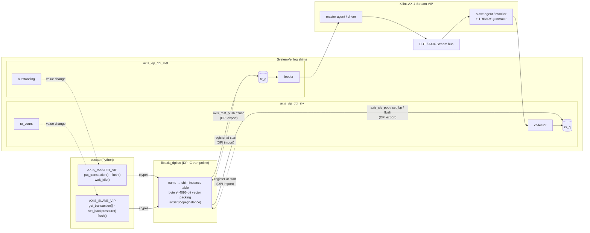
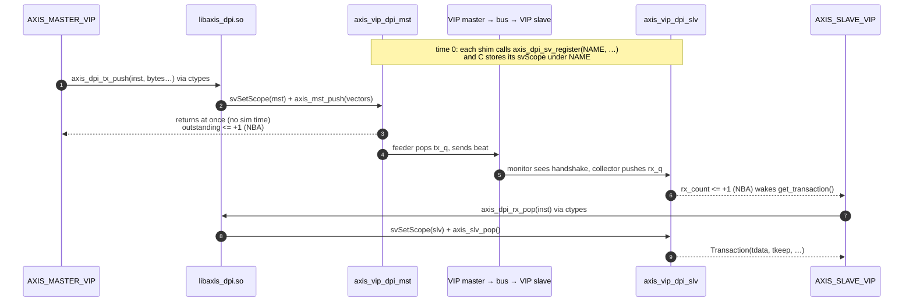

# cocotbext-axi-vip-shims

> [!CAUTION]
>    This repository is 100% vibe coded as a personal profiling project and experimental test playground.
>    Standard disclaimer applies: it works on my machine, edge cases may be ignored, and architectural decisions were made based on vibes.
>    You are completely free to use, fork, extend, modify, or break it for your own purposes. No warranties provided, but PRs and feedback are welcome!

> [!NOTE]
> **Motivation**
>
> I really like verifying with cocotb:
>
> - **Golden models are easy to write**, especially for signal processing and
>   complex algorithms, with Python libraries such as NumPy and SciPy.
> - **It runs inside pytest, so you control every step**:
>   - a pre-test routine that compiles the sources your way,
>   - a post-test routine for coverage analysis and the like,
>   - all of it vendor independent.
>
> Modern FPGA development relies heavily on interfaces. In professional work
> especially, you need to be sure your protocols, namely AXI4 (Stream, Lite and
> Full), are implemented correctly. So far the usual approach has been AXI
> drivers written in cocotb. In my experience those work, but I'm never sure
> they are always correct. For professional designs I think a better approach is
> a Python/cocotb front-end class that talks over a DPI-C interface to a
> top-level testbench holding the DUT and the Xilinx AXI VIP cores.
>
> Also, when you simulate large stimulus sets, you want as few calls between
> cocotb and the simulator as possible. Queue-based C interfacing can then make
> the simulation run faster in real time (see [Benchmark](doc/tests.md#benchmark)).

Drive the Xilinx AXI VIPs from [cocotb](https://www.cocotb.org/) through thin
SystemVerilog + DPI-C shims.

The shims add no behaviour of their own. One `put_transaction()` call in Python
is one AXI4-Stream transfer on the bus, with exactly the TDATA / TKEEP / TSTRB /
TLAST / TID / TDEST / TUSER values you passed. On the receive side, every beat
the VIP collects is handed back unchanged. Packet framing, TLAST handling and
TKEEP masking are up to the testbench.

Currently supported:

| VIP                 | Shim modules                           | Python classes                      |
|---------------------|----------------------------------------|-------------------------------------|
| AXI4-Stream (PG277) | `axis_vip_dpi_mst`, `axis_vip_dpi_slv` | `AXIS_MASTER_VIP`, `AXIS_SLAVE_VIP` |

## How it works



Solid arrows carry data. Dotted arrows are the one-time registration and the
status signals that cocotb waits on.

One transfer, from `put_transaction()` to `get_transaction()`:



- **SystemVerilog shim** ([axis_vip_dpi.sv](src/axi_vip_shims/axi_stream_vip_shim/src/hdl/axis_vip_dpi.sv)):
  holds the queues and talks to the VIP agent. All VIP API calls live in
  `vip_*` tasks, so they are easy to adapt to a different Vivado version.
- **DPI-C trampoline** ([axis_dpi.cpp](src/axi_vip_shims/axi_stream_vip_shim/src/dpi_c/axis_dpi.cpp)):
  a name → shim-instance table. It packs bytes into 4096-bit DPI vectors and
  calls the shim's exported functions with `svSetScope()` set to the right
  instance.
- **cocotb front end** ([axis_vip_dpi.py](src/axi_vip_shims/axi_stream_vip_shim/src/python/axis_vip_dpi.py)):
  loads the same `.so` with `ctypes` and checks every call against the
  interface you declared.

DPI is crossed only when cocotb pushes, pops, flushes or changes backpressure.
The shims never poll C, and cocotb waits on status signals the shims drive
(`outstanding` on the master, `rx_count` on the slave). An idle interface
therefore costs no DPI calls and no clock-edge wakeups.

The simulator (`-sv_lib`) and cocotb (`ctypes.CDLL`) must load **the same
file**, so that they share one instance table. If they don't, the first call

## Requirements

- Vivado with the AXI4-Stream VIP. You need a master and a slave VIP
  customised for your interface. For the test bench,
  [gen_vip.tcl](scripts/gen_vip.tcl)
  generates them in Vivado batch mode.
- A simulator that supports DPI-C and that cocotb can drive, and that handles
  the Xilinx VIP's SystemVerilog classes. Tested with:
  - Questa Altera Starter FPGA Edition 2025.2 (see [Questa notes](doc/questa_notes.md)),
  - Verilator 5.052 (see [Verilator notes](doc/verilator_notes.md)). Verilator
    5.032 can't build the bench.

  GHDL (VHDL only) doesn't work (see [Other simulators](doc/other_simulators.md)).
- Python 3 and cocotb.
- A C++17 compiler and CMake ≥ 3.16.

## Building the DPI library

```sh
cmake -B build
cmake --build build
```

This produces:

- `libaxis_dpi.so`: load it in the simulator and in cocotb.
- `libaxis_dpi_test.so`: `axis_dpi.cpp` linked with the mock. Used only by the
  simulator-free test.
- `libaxis_dpi_cov.so`: `libaxis_dpi.so` built with `--coverage`. The
  functional simulation tests load it in place of `libaxis_dpi.so` (see
  [Coverage](doc/tests.md#coverage)).

The two test libraries are built with `--coverage`. Turn that off with
`-DAXI_VIP_SHIMS_TEST_COVERAGE=OFF` (then there's no `libaxis_dpi_cov.so`), or
leave out both test libraries with `-DAXI_VIP_SHIMS_BUILD_TEST_LIBS=OFF`.
`libaxis_dpi.so` is never instrumented.

All of them land in the top-level `lib/` (set by `AXI_VIP_SHIMS_LIB_DIR`).

The library is deliberately linked **without** `-Wl,--no-undefined`.
`svGetScope` / `svSetScope` and the SV exports are resolved by the simulator at
load time. The exports are weak, so a design that only has masters (or only
slaves) still loads.

## Using it in a testbench

### 1. Instantiate the shims next to the VIPs

The shim parameters must match the VIP customisation:

```systemverilog
axis_vip_dpi_mst #(.NAME("mst0"), .DATA_BYTES(4),
                   .HAS_TKEEP(1), .HAS_TSTRB(1), .HAS_TLAST(1),
                   .ID_W(4), .DEST_W(4), .USER_W(4))
                   mst_shim (.aclk(aclk));

axis_vip_dpi_slv #(.NAME("slv0"), .DATA_BYTES(4),
                   .HAS_TKEEP(1), .HAS_TSTRB(1), .HAS_TLAST(1),
                   .ID_W(4), .DEST_W(4), .USER_W(4))
                   slv_shim ();
```

The shims find the VIP package, agent type and virtual interface through
macros. Their defaults match [tb_top.sv](test/axi_vip_shims/axi_stream_vip_shims/hdl/tb_top.sv);
override them at compile time to match your component and instance names:

| Macro              | Default                         |
|--------------------|---------------------------------|
| `AXIS_MST_VIP_PKG` | `axi4stream_vip_mst_pkg`        |
| `AXIS_MST_AGENT_T` | `axi4stream_vip_mst_mst_t`      |
| `AXIS_MST_VIF`     | `tb_top.mst_vip.inst.IF`        |
| `AXIS_SLV_VIP_PKG` | `axi4stream_vip_slv_pkg`        |
| `AXIS_SLV_AGENT_T` | `axi4stream_vip_slv_slv_t`      |
| `AXIS_SLV_VIF`     | `tb_top.slv_vip.inst.IF`        |

Slave-only parameters:

- `HARD_RESTART_ON_BP` (default 1): restarts the slave driver for every new
  TREADY pattern, so the pattern takes effect at once. Without it, the VIP
  queues the new pattern behind the running one. It then starts only after the
  current low/high period, after the next handshake for `"none"`, and never
  after a `"stall"`.
- `STALL_CYCLES`: the low time used for `"stall"`.

### 2. Load the library in both places

- Simulator: `-sv_lib /path/to/lib/libaxis_dpi` (or your simulator's
  equivalent). Verilator has no `-sv_lib`: link the `.so` into the model
  instead (see [Verilator notes](doc/verilator_notes.md)).
- cocotb: `AXIS_DPI_LIB=/path/to/lib/libaxis_dpi.so`, or pass
  `lib_path=` to the constructor.

### 3. Drive it from cocotb

```python
from cocotb.triggers import with_timeout
from axis_vip_dpi import AXIS_MASTER_VIP, AXIS_SLAVE_VIP

IFACE = dict(tdata_width=32, has_tkeep=True, has_tstrb=True, has_tlast=True,
             tid_width=4, tdest_width=4, tuser_width=4)

mst = AXIS_MASTER_VIP("mst0", dut.mst_shim, **IFACE)   # name == shim NAME
slv = AXIS_SLAVE_VIP("slv0", dut.slv_shim, **IFACE)

mst.put_transaction(tdata=0x11111111, tlast=False, tid=2)
mst.put_transaction(tdata=0x22222222, tlast=True, tkeep=0b0011, tstrb=0b0011)

slv.set_backpressure("random", low=(0, 8), high=(1, 4))
t = await with_timeout(slv.get_transaction(), 100, "us")
# Transaction(tdata, tkeep, tstrb, tlast, tid, tdest, tuser)

await mst.wait_idle()
```

The constructor describes the interface. On first use, the description is
checked against the shim's parameters and any mismatch is reported field by
field. You can call `check()` to run that check early.

## Examples

[examples/axis_byteswap/](examples/axis_byteswap/) is a small standalone
project that tests its own DUT through the shims. It is laid out like a
separate repository that has the shims as a git submodule. It shows how to
build `libaxis_dpi.so` from your own CMake (`add_subdirectory`), how to compile
the VIP and shim sources with your bench, how to override the shim macros for
your VIP component names, and how to run the bench on Verilator and on Questa:

```sh
cd examples/axis_byteswap && pytest    # SIM=questa pytest for Questa
```

## Documentation

- [API summary](doc/api_summary.md): every call and attribute of `AXIS_MASTER_VIP` / `AXIS_SLAVE_VIP`
- [Debug log](doc/debug_log.md): `AXIS_DPI_DEBUG=1`: one line per call in the Python, C and SV layers
- [Tests](doc/tests.md): simulator-free and simulation tests, coverage, test artifacts, your own VIP sources, benchmark
- [Questa notes](doc/questa_notes.md): what the shims need on Questa
- [Verilator notes](doc/verilator_notes.md): how the Verilator flow differs, and why
- [Other simulators](doc/other_simulators.md): what doesn't work
